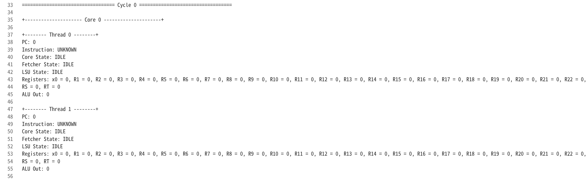

# Abyss

**一个从 RTL 一直做到编译器后端的 SIMD GPU。**

起点是 [tiny-gpu](https://github.com/AdamMajmudar/tiny-gpu) 那个"用不到 15 个文件讲清 GPU 硬件"的教学项目。
本项目把它的 ISA 换成了与 RISC-V **逐位兼容**的 **Abyss ISA**，并补齐了原生 LLVM/Clang 后端、
完整的 ISA 手册和一套 C 驱动的硬件回归测试 —— 也就是说，现在写 GPU kernel 不再需要手写汇编，
直接写 C、用 `clang --target=abyss` 编译即可。

| 层 | 内容 |
| - | - |
| RTL | SystemVerilog，4 个 core × 16 线程，每线程独立的 ALU / LSU / PC / 寄存器堆 |
| ISA | 43 条指令，RV32I + M 兼容（仅 `RET` 为自定义），32 位定长编码 |
| 编译器 | `clang --target=abyss`（LLVM 22 后端 + Clang target），`ld.lld` 链接 |
| 验证 | cocotb + Icarus Verilog / **Verilator**，整数与多分辨率光栅化 C 内核用例，逐拍执行 trace |


---

## 目录

- [快速开始](#快速开始)
- [仓库结构](#仓库结构)
- [架构](#架构)
- [Abyss ISA](#abyss-isa)
- [C 工具链](#c-工具链)
- [测试](#测试)
- [与 tiny-gpu 的差异](#与-tiny-gpu-的差异)
- [后续计划](#后续计划)
- [致谢](#致谢)

---

## 快速开始

```bash
# 依赖：iverilog、sv2v、cocotb(+python3)、ld.lld；可选 Verilator（快 5×）
# 编译器与汇编器来自本机的 LLVM 构建（见「C 工具链」一节）

make test matadd      # 跑单个用例
make test CASE=matadd # 等价写法
make test_matadd      # 等价写法
make sim              # 只构建 RTL 仿真器（build/sim.vvp）
make compile          # 只做 sv2v 转换（SystemVerilog → Verilog）
```

运行结束后日志落在 `test/logs/`，里面包含初始数据内存、逐拍执行 trace 和最终数据内存。

工具链路径可以在命令行覆盖：

```bash
make -C test/matadd ABYSS_CLANG=/path/to/clang LLVM_MC=/path/to/llvm-mc
```

---

## 仓库结构

```
src/                  RTL（SystemVerilog）
  gpu.sv              顶层：core 数组 + 内存控制器 + DCR
  core.sv             fetcher / decoder / scheduler / 线程数组
  scheduler.sv        8 状态控制流（IDLE → FETCH → DECODE → REQUEST → WAIT → EXECUTE → UPDATE → DONE）
  fetcher.sv          PC 取指
  decoder.sv          opcode → funct3 → funct7 三级译码，产出全部控制信号
  alu.sv              算术 / 移位 / 比较 / 位运算 / 除法器
  lsu.sv              字节地址 → 字地址 + lane，窄访存扩展与写掩码
  pc.sv               分支条件、PC 相对跳转、JAL/JALR 链接值
  registers.sv        32 × 32 位寄存器堆（x0 恒 0）
  dispatch.sv         block 分配与 done
  dcr.sv              Device Control Register（写入线程数）
  controller.sv       内存请求仲裁

docs/isa.md           Abyss ISA 手册（唯一副本）
docs/images/          架构图与 trace 截图
tools/
  abyss.h             内核侧接口：abyss_mem()、blockIdx/threadIdx、矩阵类型与运算宏
  run_abyss.py        已过时的 Python ISA 模拟器（禁止用于验证）
  render_raster.py    已过时的 Python 渲染器（禁止用于验证）
  pixels_to_image.py  RTL 帧缓冲像素转 PNG/PPM
  examples/           示例 C 内核
  README.md           C 工具链与测试的详细说明
test/
  helpers/            cocotb 脚手架（内存模型、setup、trace 反汇编）
  common.mk           所有用例共用的构建规则
  <case>/             每个用例自带 Makefile + src/ + test_<case>.py
abyss-vivado/         Vivado 工程
gds/                  GDSII 布局结果
```

---

## 架构


一个 GPU 由 **4 个 core** 组成，每个 core 负责一个 block、最多 **16 个线程**（`THREADS_PER_BLOCK`）。
同一 core 内的线程**共享一个 fetcher 和一个 decoder**，但各自拥有独立的 ALU、LSU、PC 和寄存器堆 ——
这就是 SIMD 在硬件上的样子：一条指令，多个数据通路同时执行。


关键点：

1. **控制流是 8 个状态的硬状态机**，不用流水线。所有线程每拍收敛到同一 PC（不支持分支发散）。
2. **内存是外部的、异步的、多通道的**：每个 core 的 4 个 LSU 通过 controller 共享 4 条数据通道，
   内存接口只有 `valid / address / data / ready`，外加 `write_mask` 4 位字节使能。
3. **数据内存按字节寻址**。`LSU` 负责 `byte_address >>> 2` 得到字地址、`byte_address[1:0]` 得到 lane，
   窄读时做符号/零扩展，窄写时把数据移进 lane 并生成字节掩码 —— 这样 C 里的 `char`/`short` 和指针演算才成立。
4. **`x0` 恒为 0**，`R29/R30/R31` 是只读的 `%blockIdx` / `%blockDim` / `%threadIdx`。
5. **每个 core 带一个指令 cache**（直接映射，128 行 × 1 条指令，可调）。命中时不再访问
   program memory，`FETCH` 只占 1 拍、直接进 `DECODE`；未命中才去 RAM 取一次并把该行装进 cache。
   分支/循环因此不再付重复取指的代价（详见 [`docs/isa.md`](docs/isa.md) 第 6 章）。


---

## Abyss ISA

完整的手册在 **[`docs/isa.md`](docs/isa.md)**（位域、编码速查、每条指令的控制信号、版本历史都在里面）。
概要如下：

| 类型 | 条数 | 指令 |
| - | - | - |
| R | 15 | `ADD` `SUB` `MUL` `DIV` `DIVU` `REM` `REMU` `SLT` `SLTU` `AND` `OR` `XOR` `SLL` `SRL` `SRA` |
| I | 15 | `ADDI` `SLTI` `SLTIU` `ANDI` `ORI` `XORI` `LDR` `LB` `LH` `LBU` `LHU` `SLLI` `SRLI` `SRAI` `JALR` |
| S | 3 | `STR` `SB` `SH` |
| B | 6 | `BEQ` `BNE` `BLT` `BGE` `BLTU` `BGEU` |
| U | 2 | `LUI` `AUIPC` |
| J | 1 | `JAL` |
| custom-2 | 1 | `RET`（线程结束） |

除 `RET` 外，所有指令的编码与 RISC-V 官方规范**逐位一致**（`opcode` / `funct3` / `funct7` 完全对齐，
包括 M 扩展 `funct7 = 0000001` 与 `funct3 100/110/111` 的逻辑运算复用）。这意味着：

- 可以用 `llvm-mc -arch=abyss` 汇编，也可以用 RISC-V 工具链交叉验证编码；
- 编译器只需要把 RISC-V 那套 lowering 搬过来，几乎没有"新语义"要发明。

几条实现上的约定：

- **数据按字节寻址**，`LDR rd, 4(rs1)` 是"字节 4"（第 1 个字），不是"第 4 个字"。
- **PC 按指令条数计**，但所有 PC 相关量（分支偏移、`JAL`/`JALR` 链接值、`AUIPC`）按 **字节地址** 语义 ——
  `PC_byte = current_pc << 2`，换算只是接线。
- **除零不 trap**：`DIV`/`DIVU` 返回全 1，`REM`/`REMU` 返回被除数，`INT_MIN / -1` 回绕；
  对齐错误也不 trap（按所在字 + lane 截断处理）。这些都记在手册第 9 章。

---

## C 工具链

这是一条**真正的编译器链路**，不是文本替换：

```
src/<case>.c
  │  clang --target=abyss -O2 -fno-pic -fno-delete-null-pointer-checks -nostdlib -c
  ▼
build/<case>.o ──┐
                 ├─ ld.lld --image-base=0 -Ttext=0 -e _start
src/start.s      │
  │ llvm-mc      │
  ▼              │
build/start.o ───┘
  ▼
build/<case>.elf
  │  llvm-objcopy -O binary --only-section=.text
  ▼
build/<case>.bin  →  cocotb 载入 program memory → RTL 仿真
```

### LLVM 后端

后端源码在 `llvm-project` 的 `llvm/lib/Target/Abyss/`（分支 `abyss`，基于 LLVM 22.1.8）：

| 文件 | 作用 |
| - | - |
| `Abyss.td` / `AbyssRegisterInfo.td` | target 与寄存器描述 |
| `AbyssInstrFormats.td` | R/I/S/B/U/J 六种指令格式的 TableGen 类 |
| `AbyssInstrInfo.td` | 43 条指令的编码与汇编语法 |
| `AbyssCodeGen.cpp` | 指令选择、调用约定、帧管理 |
| `AbyssMCAsmInfo.h` / `MCTargetDesc/` / `AsmParser/` | MC 层、汇编器、目标文件写出 |
| `AbyssTargetMachineImpl.cpp` / `AbyssTargetInfo.cpp` | TargetMachine 与 TargetInfo |

### Clang 移植

`clang/lib/Basic/Targets/Abyss.cpp` 提供 `clang --target=abyss` 所需的 TargetInfo（数据类型宽度、
`__SIZEOF_*`、预定义宏等），配合上表的 CodeGen 即可直接编译 freestanding 的 C 内核。

### 重新构建

```bash
ninja -C ~/llvm-project/build llvm-mc llvm-objcopy   # 汇编器 + objcopy
ninja -C ~/llvm-project/build-abyss-clang clang      # Abyss Clang
```

> ⚠️ 改过 `.td` 之后**必须**重跑 `ninja llvm-mc`，否则汇编器仍会报 `unrecognized instruction mnemonic`。

### 内核侧怎么写

```c
#include "abyss.h"

void kernel(void) {
  int i = __abyss_linear_idx();   // blockIdx * blockDim + threadIdx

  int *A = (int *)abyss_mem(0);      // 字节地址 0
  int *B = (int *)abyss_mem(32);
  int *C = (int *)abyss_mem(64);

  C[i] = A[i] + B[i];
}
```

矩阵还可以用 `ABYSS_MATRIX` 声明带维度/元素类型的类型，再用 `ABYSS_MAT_ADD` / `ABYSS_MAT_MUL`
让 `_Static_assert` 在**编译期**检查维度与元素类型（详见 [`tools/README.md`](tools/README.md)）。

支持的 C 子集：`int`/`unsigned`/`char`/`short`、算术、位运算、移位、除余、比较、分支、循环、
`phi`/`select`、`alloca`、函数调用（≤8 参数）。不支持浮点、64 位、全局变量、PIC、libc、可变参数。

---

## 测试

每个用例的流程是"写 C → 编译链接 → 载入 RTL → 跑完 `done` → 用 Python 参考模型逐字比对内存"。

| 用例 | 覆盖内容 |
| - | - |
| `matadd` | 4 线程矩阵加法，最基本的 SIMD 通路 |
| `matmul` | 2×2 矩阵乘法，嵌套循环 + 偏移寻址 |
| `shift` | `SLL`/`SRL`/`SRA` 与立即数版，含移位量 mod 32 |
| `mem` | 字节/半字访存、lane 选择、写掩码合并 |
| `div` | `DIV`/`DIVU`/`REM`/`REMU` + 四种除零情况 |
| `slt` | `SLT`/`SLTU`/`SLTI`/`SLTIU`，含负立即数与无符号比较 |
| `logic` | `AND`/`OR`/`XOR` 与立即数版、`~a`、位域提取 |

全部用例通过（cocotb 2.1，Icarus Verilog 13 与 Verilator 5.046 两套后端结果一致），sv2v 与 iverilog 零告警。

### 仿真器选择

`make test <case>` 默认走 iverilog；加 `SIM=verilator` 换成 Verilator，**同一拍数、快 5 倍以上**：

| 用例 | icarus | verilator |
| - | - | - |
| `raster128x128` | 108 s | **20 s** |
| `raster32x32` | 6.1 s | 2.6 s |
| `matadd` | 1.6 s | 0.8 s |

```bash
make test raster128x128 SIM=verilator
```

Verilator 的安装（无需 root）与变量覆盖见 [`test/README.md`](test/README.md)。
❗ 两个仿真器对 `INT_MIN / -1` 这种有符号除法溢出的定义不同（Icarus 回绕成 `0x80000000`，
Verilator 给 `0`），`alu.sv` 现在把该情况显式钉成 RISC-V 语义。
仿真可以在 `test/logs/` 里看到逐拍 trace：



---

## 与 tiny-gpu 的差异

| 项 | tiny-gpu | Abyss |
| - | - | - |
| 指令集 | 11 条自定义指令，16 位定长 | **43 条**，32 位定长，RV32I+M 逐位兼容 |
| 寄存器 | 16 个（4 位编号），`R0`–`R12` 可写 | **32 个**（5 位编号），`x0` 恒 0 |
| 访存 | 字寻址，无偏移 | **字节寻址** + imm12 偏移 + 字节/半字 × 符号/零扩展 + 写掩码 |
| 分支 | `CMP` 写 NZP 寄存器，再由 `BRnzp` 判断（两条指令） | **B 型单条指令内比较**，`JAL`/`JALR` 调用返回 |
| 算术 | `ADD` `SUB` `MUL` `DIV` | 再加 `DIVU` `REM` `REMU`、移位、比较、位运算 |
| 常量 | `CONST imm12` | `LUI` + `AUIPC` + `ADDI`（`LI` 为伪指令） |
| 写 kernel | 手写汇编 | **写 C，`clang --target=abyss` 编译** |
| 除零 | 未定义（Verilog `/0` 产生 `x`，污染整条数据通路） | 按 RISC-V 返回定值 |

原始项目保留了完整的架构讲解（cache、warp、memory coalescing 等进阶话题），
那些讨论对本项目依然适用，这里不再重复。

---

## 后续计划

- [ ] `MULH`/`MULHU`/`MULHSU`（需要 64 位乘法器，为 64 位整数运算铺路）
- [ ] 指令 cache
- [ ] 分支发散支持（需要 PC 栈 + 重聚机制）
- [ ] memory coalescing
- [ ] 流水线与 warp 调度
- [ ] 后端支持向量类型，把矩阵宏换成 `__attribute__((matrix_type))` + Clang builtins
- [ ] Tiny Tapeout 流片适配
- [ ] Vivado环境移植

---

## 致谢

### 原项目

本项目脱胎于 **tiny-gpu**，作者 **Adam Majmudar**
（<https://github.com/AdamMajmudar/tiny-gpu>）。

调度器的 8 状态控制流、共享 fetcher/decoder 的 SIMD 组织方式、多核 + 多通道异步内存接口、
以及 cocotb 测试脚手架的最初形态，都直接继承自该项目。它"用不到 15 个文件把 GPU 讲清楚"的
取舍，是这个项目能够继续往上加 ISA 和编译器的前提 —— 在此郑重致谢。

### AI 协作

本项目以下三块工作使用了 **DeepSeek**（深度求索）的模型作为编程助手：

1. **Abyss LLVM 后端** —— `llvm/lib/Target/Abyss/`：TableGen 指令/寄存器/格式描述、MC 层与汇编器、
   指令选择与调用约定。
2. **Clang 移植** —— `clang/lib/Basic/Targets/Abyss.cpp` 等，让 `clang --target=abyss` 能直接编译
   C 内核并产出可链接的目标文件。
3. **RTL 测试** —— 7 个 cocotb 用例的 C 内核、参考模型与联调排错（包括发现并修复
   Verilog 有符号性导致的 `div` 静默变 `divu`、LLVM 把 `a/b`+`a%b` 折叠成 `div`+`mul`+`sub`
   导致 `rem` 测不到这类问题）。

架构取舍、ISA 决策与最终代码评审由人类完成；AI 承担实现、查错与文档同步。

---

## 许可与上游

本仓库是基于 tiny-gpu 的衍生作品，原项目版权归 Adam Majmudar 所有。
本仓库目前未单独声明许可证；如需再分发，请同时遵守原项目的条款。
